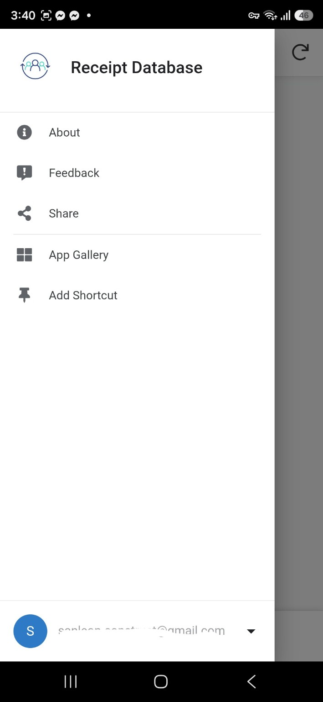
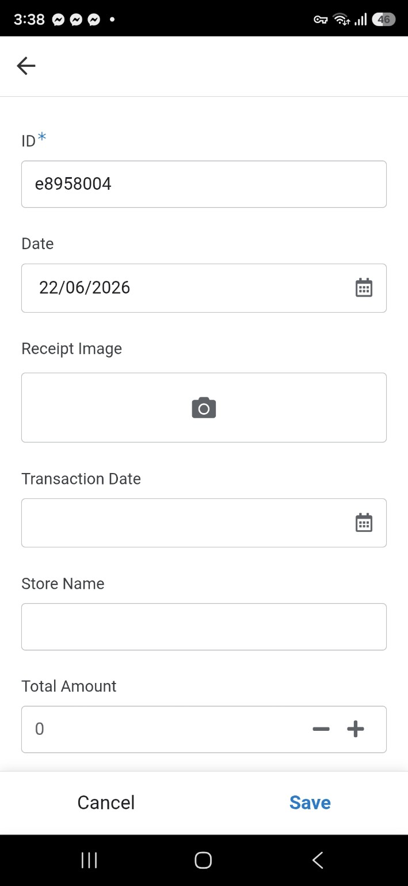
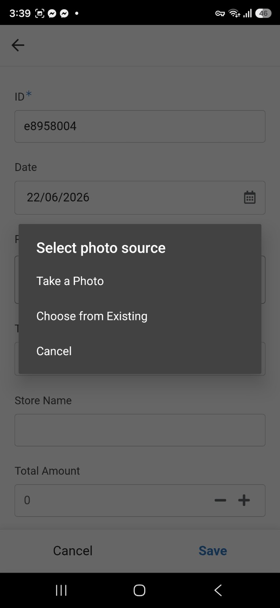
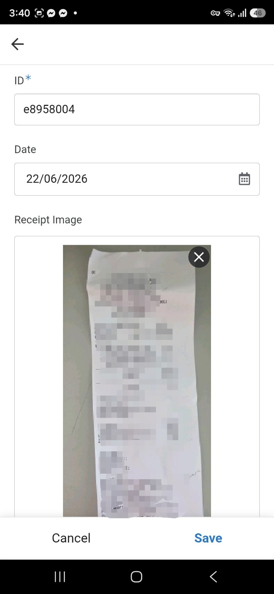

# Receipt Scanner

Turns receipt photos into structured spreadsheet rows. A receipt photo is uploaded through an AppSheet form, and a Google Apps Script reads it with Gemini vision and fills in the store name, date, total, and VAT automatically. No manual retyping.

> Status: working MVP. v1 (Drive OCR) is the version currently deployed. v2 (Gemini vision) is built and being tested. Both are kept in this repo to show how the approach evolved.

## How it works (v2, Gemini vision)

1. A receipt photo is uploaded through an AppSheet mobile form. The image is saved to Google Drive and a new row is added to the Google Sheet.
2. A time-driven Apps Script trigger runs `scanReceiptImages()`.
3. For each row that has an image but no RawText yet, the script finds the image in Drive and sends it to Gemini (`gemini-2.0-flash`) with a prompt asking for structured JSON.
4. The script writes the store name, transaction date, total, and VAT into the sheet, and keeps Gemini's raw JSON response in the RawText column for debugging.

Design choices:
- **Temperature 0 and JSON output**, so results are consistent and easy to parse.
- **"Use null if unsure" in the prompt**, so the model leaves a field empty rather than guessing.
- **Retry-safe**: if extraction fails, RawText stays empty and the row is picked up again on the next run.
- **Capped at 5 receipts per run**, to protect API usage and Apps Script time limits.

## Versions

| Folder | Approach | Notes |
|---|---|---|
| `v1-drive-ocr/` | Google Drive OCR, then regex and keyword parsing | Includes fixes for OCR mistakes seen in real receipts (WAT to VAT, AMOUR to AMOUNT). Works, but breaks on unusual layouts. |
| `v2-gemini-vision/` | Gemini reads the image and returns JSON | Replaces the brittle parsing with one model call. Newer version, being tested before it replaces v1. |

## Sheet layout

| Col | Field | Filled by |
|---|---|---|
| A | ID | AppSheet |
| B | Date | AppSheet |
| C | Receipt Image | AppSheet |
| D | Transaction Date | Script |
| E | Store Name | Script |
| F | Total Amount | Script |
| G | Tax / VAT | Script |
| H | RawText (raw Gemini JSON) | Script |
| I | UploadedBy | AppSheet |

## Setup

1. Create a Google Sheet with the columns above (the sheet tab named `Sheet1`).
2. Open Extensions > Apps Script and paste in `v2-gemini-vision/Code.gs`.
3. Replace `YOUR_SHEET_ID` at the top of the script with your spreadsheet ID.
4. In Project Settings > Script Properties, add `GEMINI_API_KEY` with your Gemini API key. Never put the key in the code.
5. Run `scanReceiptImages()` once manually and approve the permissions.
6. Add a time-driven trigger for `scanReceiptImages` (for example every 5 minutes).

## Screenshots

### Receipt Database Menu

### Receipt Entry Form

### Photo Source Selection

### Receipt Image Uploaded

## Known limitations

- **Accuracy has not been formally measured.** [Fill in only if you tested: "Tested on N sample receipts, X of Y totals correct."]
- **The Drive file is found by file name.** Duplicate file names could match the wrong image.
- **The model name is hardcoded** (`GEMINI_MODEL`). Model versions get retired, so update it if calls start failing.
- **The `confidence` field is requested but not used yet.** Flagging low-confidence rows for manual review is a planned improvement.
- **Review results before using them for accounting.** AI can misread amounts on blurry or low-contrast receipts.

## Roadmap

- Flag low-confidence rows with a "Needs Review" column.
- Match images by Drive file ID instead of file name.
- Measure accuracy on a labeled set of receipts.
- Use as an intake layer for expense tracking and rental-billing automation.

## License

See `LICENSE.md`.
